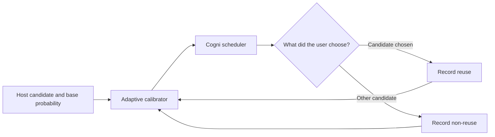

A static rule can know that `/orders` is a plausible next page. It cannot know that this particular
person, on this particular device, opens orders after home almost every morning.

Adaptive calibration closes that gap. Browser-owned Cogni runtimes enable it by default. It learns whether an approved destination was actually reused,
then carefully adjusts the probability the host already supplied. Cogni still decides whether the
final candidate clears its quality gate. The application still decides which destinations are safe to
consider.

## The feedback loop



The model stores two time-decayed weights for a transition: reuse and material non-reuse. It does not
need a raw browsing log. A transition is scoped by:

- an application namespace;
- an opaque user-device subject key;
- a host-defined context such as the current route; and
- the already-approved destination.

Old observations lose influence with a configurable half-life. The default is 14 days, so the model
adapts when a person's routine changes instead of preserving an old habit forever.

## Conservative by design

What should happen after only one click? Nothing.

The host probability acts as the prior. By default, Cogni waits for five effective observations before
personalization can move the score. Confidence then grows gradually, and the adjustment is capped at
`0.2`. Sparse evidence therefore stays close to the host policy while repeated behavior earns more
influence.

Operational failures are not behavioral evidence. Choice learning observes committed navigation
against the host's approved candidate set, including candidates that stayed below the prediction gate.
Outcome learning accepts only material predictions that finish as `reused` or `missed`; rejected,
cancelled, failed, and already-cached work do not change the model.

## Give Cogni an identity

Cogni needs one value it cannot safely infer: an opaque stable key for the authenticated account.
Once supplied, learning is automatic. There is no learning flag to enable or disable.

```tsx
<CogniProvider opaqueUserKey={session.opaqueUserKey}>
  <App />
</CogniProvider>
```

The provider combines that account key with a random browser-profile key, calibrates every scheduled
candidate before admission, and records material terminal outcomes after completion.

## Use the model directly

Low-level runtimes can construct the same model explicitly:

```ts
import { AdaptivePredictionCalibrator } from "@inttegro/cogni-client/learning";
import { IndexedDbAdaptiveCalibrationStore } from "@inttegro/cogni-client/learning/browser";

const calibrator = new AdaptivePredictionCalibrator({
  namespace: "merchant-dashboard",
  store: new IndexedDbAdaptiveCalibrationStore(),
  halfLifeMs: 14 * 24 * 60 * 60 * 1_000,
  minimumEvidence: 5,
  maxAdjustment: 0.2,
});
```

The core contract is storage-agnostic. Use `InMemoryAdaptiveCalibrationStore` in deterministic tests
or supply an `AdaptiveCalibrationStore` backed by infrastructure you control. The browser adapter uses
an atomic IndexedDB transaction for each update.

## Identify the subject

Cogni does not inspect authentication. Give it an opaque user key and a random browser-profile key:

```ts
import {
  composeUserDeviceSubjectKey,
  getOrCreateCogniDeviceKey,
} from "@inttegro/cogni-client/learning/browser";

const subjectKey = composeUserDeviceSubjectKey(
  session.opaqueUserKey,
  getOrCreateCogniDeviceKey(),
);
```

`opaqueUserKey` must not be an email address, phone number, or other direct identifier. The generated
device key is random; it does not fingerprint hardware. Keep anonymous activity separate unless your
product has an explicit policy for associating it after sign-in.

Signing out should stop using the subject key. Account deletion, a privacy reset, or the end of your
retention period should call `calibrator.clearSubject(subjectKey)`. Server synchronization and
cross-device learning are not part of the local reference implementation.

If IndexedDB is cleared, replaced, blocked, or unavailable, Cogni treats the next observation as a
cold start. Prediction continues with the host probability and a fresh in-memory model; storage can
never make navigation fail.

## Calibrate, then schedule

```ts
const contextKey = location.pathname;
const { candidate: calibrated } = await calibrator.calibrate({
  subjectKey,
  contextKey,
  candidate: {
    key: "orders",
    policy: "navigation",
    trigger: "idle",
    destination: "/orders",
    probability: 0.62,
    horizonMs: 5_000,
  },
});

const handle = coordinator.predict(calibrated, loadOrders);
```

The returned candidate carries inspectable calibration metadata but never the subject key. Passing an
already-calibrated candidate through the model again does not compound the adjustment; Cogni recovers
the original base probability from that metadata.

## Close the loop

```ts
await calibrator.observeChoice({
  subjectKey,
  contextKey,
  chosenDestination: nextPath,
  consideredDestinations: approvedCandidates.map(({ destination }) => destination),
});
```

`observeChoice()` is how Cogni can learn a browsing transition even when no predictive request ran.
The chosen destination gains evidence; the other considered destinations gain non-reuse evidence. The
set is deduplicated and bounded to 32 destinations by default.

When material prediction outcomes are the desired signal, use `observe()` instead:

```ts
const result = await handle.completion;
await calibrator.observe({ subjectKey, contextKey, result });
```

Do not feed one decision into both methods in the same namespace. Call `handle.markReused()` only when
the committed action consumes the predicted route payload or data cache entry. That reuse definition
remains the difference between useful anticipation and invisible waste.

Cogni DevTools displays the final probability alongside the base probability and effective evidence.
You can see whether personalization is earning its influence rather than trusting an opaque score.

## Keep the boundary

Adaptive calibration weights candidates; it does not generate them. The application must continue to:

- authorize every predicted read using the normal request identity;
- provide the candidate allowlist and base probability;
- preserve ordinary navigation when prediction fails;
- choose retention, consent, and deletion policy; and
- verify that learned predictions improve reuse and latency without increasing waste.

The model should become more useful as it learns, never more powerful than the application that hosts
it.
