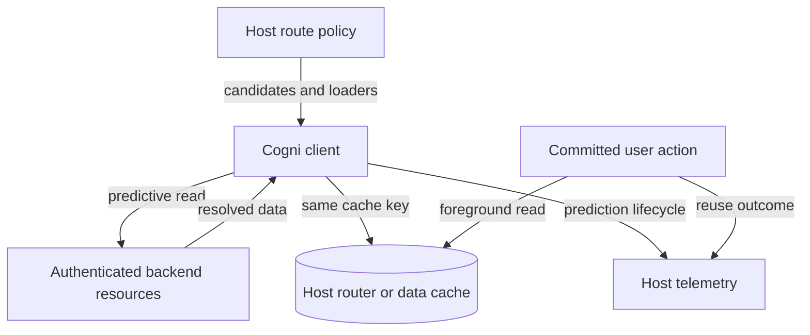

Cogni coordinates **when** approved reads begin. The host retains authority over **what** can be
read, **who** may read it, and **where** it becomes reusable.

Prediction and navigation must meet in the same host cache.

## Client

The client shares one budget across candidate signals. It owns:

- candidate admission through probability and cost gates;
- concurrency, queue bounds, priority, deduplication, deadlines, and cancellation;
- activity-aware scheduling and direct-intent escalation;
- optional browser visibility and connection gates;
- lifecycle events and in-memory reuse accounting; and
- a typed client for the language-neutral backend protocol.

The host supplies the loader. Cogni controls timing and observes cost; the host owns the data.

## Backend protocol

The optional protocol batches approved reads and returns them as they finish:

- `capabilities` describes supported transports, representations, and limits;
- `predictions` evaluates a bounded batch and returns lifecycle events; and
- `outcomes` records whether resolved work was reused.

Opaque names such as `products.page` prevent the browser from inventing work. Version 1 supports
buffered JSON and NDJSON; any backend language may implement the wire contract.

## Host application

The host continues to own:

- authentication, authorization, tenancy, and request context;
- the route graph and which destinations are safe to predict;
- resource registration and every read implementation;
- cache identity, freshness, invalidation, and representation reuse;
- the source and calibration of candidate probabilities;
- foreground activity and browser policy signals;
- telemetry storage and rollout decisions; and
- all mutations and external side effects.

Cogni reserves no route prefix and mounts nothing automatically.

## Authorization

Authenticate before a Cogni handler and apply foreground authorization inside each resolver. Keep
authorization ahead of data access and cache population; Cogni payloads never carry credentials.

## Cache and reuse

Stable, tenant-aware cache keys enable deduplication and reuse. Report `reused` only when the
foreground path consumes the predicted representation; otherwise report `missed` or `expired`.

## Cancellation

Cogni uses `AbortSignal` for host cancellation and deadlines. Host I/O must honor it, while the
foreground request remains available.

## Portability

Portability comes from protocol version 1 and its conformance fixtures. Non-Node backends implement
the lifecycle defined in the [backend contract](/cogni/backend-contract).

## Continue

- [How Cogni works](/cogni/how-cogni-works) explains the design behind these boundaries.
- [Client quickstart](/cogni/client-quickstart) creates a first reusable prediction.
- [Node server quickstart](/cogni/server-quickstart) registers and resolves a read-only resource.
- [Backend contract](/cogni/backend-contract) specifies the language-neutral operations.
