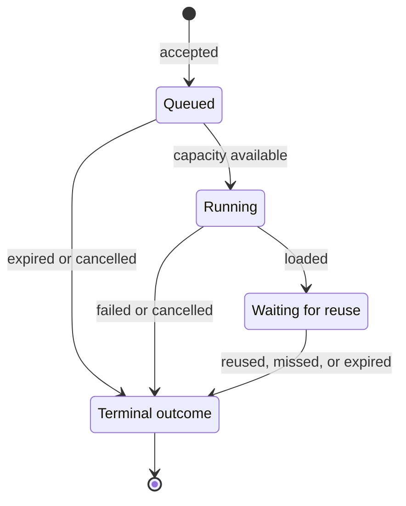

A candidate binds host intent to a reusable read, probability, horizon, and cost. Cogni then admits,
orders, deduplicates, cancels, and measures the work.

## Candidate fields

`PredictionCandidate` makes the decision inspectable:

| Field            | Required | Meaning                                                                                  |
| ---------------- | -------- | ---------------------------------------------------------------------------------------- |
| `cost`           | No       | `low`, `standard`, or `high`; defaults to `standard` and selects the confidence gate.    |
| `destination`    | Yes      | Human-readable resource or destination name used for telemetry filtering.                |
| `estimatedBytes` | No       | Expected bytes used until the loader reports actual bytes; defaults to `0`.              |
| `horizonMs`      | Yes      | Positive time from acceptance in which reuse must happen.                                |
| `key`            | Yes      | Stable identity used for active-work deduplication, cancellation, and reuse attribution. |
| `policy`         | Yes      | Name of the host policy that produced the candidate.                                     |
| `priority`       | No       | Higher values run first within the bounded queue; defaults to `0`.                       |
| `probability`    | Yes      | Calibrated probability from `0` through `1`.                                             |
| `trigger`        | Yes      | Signal that produced the candidate, such as `idle`, `hover`, or `focus`.                 |

Malformed candidates throw `TypeError` before admission.

## Admission and deduplication

`predict(candidate, loader)` returns immediately. Inspect `accepted` before assuming work entered the
queue:

```typescript
const handle = coordinator.predict(candidate, loader);

if (!handle.accepted) {
  const result = await handle.completion;
  console.info("prediction rejected", result.reason);
}
```

Defaults are `0.8` for ordinary work, `0.9` for high-cost work, two loaders, and 16 queued items.
Matching keys return the active handle with `deduplicated: true`. Queued work sorts by priority,
probability, then insertion order.

## Lifecycle



`waiting_for_reuse` separates completion from usefulness. The host must report consumption before
the horizon ends.

The corresponding events are:

- `accepted` when the candidate enters active work;
- `started` immediately before Cogni calls the loader;
- `loaded` when the loader resolves;
- `reused` when the host reports that committed work consumed the same resource;
- `missed`, `failed`, `cancelled`, or `expired` at terminal completion;
- `rejected` when admission fails; and
- `deduplicated` when an existing active key is reused.

`onEvent` failures are isolated from the lifecycle.

## Mark reuse

Call `handle.markReused()` only when the committed action reads the same cached representation.

Reuse reported during loading finalizes after completion. Reuse while still queued becomes
`superseded_by_committed_action`.

Do not mark reuse for these cases:

- the foreground action fetched a different cache key or payload shape;
- the predicted entry expired or was invalidated first;
- navigation changed to another destination; or
- the application merely observed that the prediction request completed.

## Cancellation

Cancel through the handle or stable key:

```typescript
handle.cancel();
coordinator.cancel(candidate.key);
```

Active loaders receive an aborted signal. `dispose()` uses `coordinator_disposed`; host cancellation
uses `cancelled_by_host`.

## Measure quality

`quality(filter?)` reads bounded terminal history filtered by `cost`, `destination`, `policy`, or
`trigger`.

```typescript
const pointerQuality = coordinator.quality({
  policy: "account-navigation",
  trigger: "pointer",
});

console.info({
  materialOutcomes: pointerQuality.materialOutcomes,
  reuseRate: pointerQuality.reuseRate,
  byteReuseRate: pointerQuality.byteReuseRate,
});
```

History retains 1,000 terminal outcomes by default. Persist events in host telemetry for durable or
cross-user analysis.

## Continue

- [Why Cogni](/cogni/why-cogni) explains the production quality target.
- [Scheduling and direct intent](/cogni/scheduling-and-intent) controls when admitted work reaches the
  coordinator.
