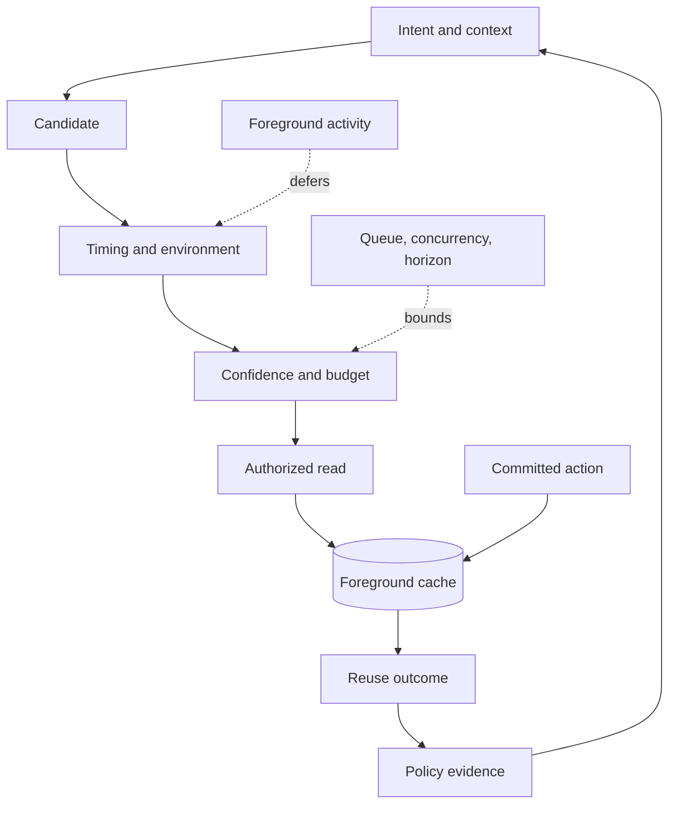

Cogni adapts the idea behind
[**CPU branch prediction**](https://www.intel.com/content/dam/doc/manual/64-ia-32-architectures-optimization-manual.pdf).
A processor begins the likely next path before the branch settles. A correct prediction avoids a
stall; a wrong one is discarded.

Applications have similar clues in pointer movement, focus, the current route, and recent navigation.
Cogni begins a likely read before commitment and preserves its value only when foreground work
consumes it.

There is an important difference: a CPU can roll back speculative machine state, but network and
backend work cannot be unspent. Cogni therefore limits speculation to authorized reads and governs
it with confidence gates, shared budgets, cancellation, and measured reuse.

## Why predict

Predictive loading does not make a server faster. It moves an authorized read off the user's critical
path. If a 400 ms read begins 250 ms before commitment, the foreground path waits about 150 ms instead
of 400 ms. Cogni has hidden 250 ms, or 62.5 percent of that dependency's latency.

| Read latency | Lead time | Wait after commitment | Wait hidden |
| -----------: | --------: | --------------------: | ----------: |
|       200 ms |     80 ms |                120 ms |         40% |
|       400 ms |    250 ms |                150 ms |       62.5% |
|       300 ms |    350 ms |                  0 ms |        100% |

These are illustrative upper bounds, not benchmark results. A useful estimate across many opportunities
is `reuse probability × min(lead time, read latency)`. With 80 percent reuse and 250 ms of useful lead,
the average wait avoided is 200 ms per opportunity. The remaining predictions spend resources without
helping the user, which is why Cogni measures reuse, bytes, and timing instead of celebrating completed
requests.

## Predict

The host turns a signal into a candidate: a stable cache key, trigger, policy, probability, horizon,
cost, estimated bytes, and priority. Together they form a testable claim, such as “this
representation has an 88 percent chance of being consumed within five seconds.”

The host makes this claim from application-specific knowledge.

## Wait

Useful work can begin at the wrong time. The scheduler waits for configured delays, browser
eligibility, foreground quiet, or idle time. Stronger intent such as focus, touch, or pointer-down
can promote a candidate immediately.

## Bound

Every candidate competes for one speculative budget. Confidence gates reject weak or expensive
guesses. Stable keys collapse duplicates. Priority orders the queue, while concurrency, queue length,
and horizons cap total work.

Cogni yields to foreground activity and keeps ordinary navigation available.

## Read

An admitted loader may prefetch a route, populate a query cache, or request a registered backend
resource. The host authenticates, validates, authorizes, and owns freshness.

Only reads qualify. A prediction never submits, sends, purchases, publishes, or deletes.

## Reuse

The host cache is where speculation meets committed work. The loader writes the same representation
under the same key that ordinary navigation will read.

When the user commits, the foreground path proceeds normally. If it consumes that entry before
expiry or invalidation, the host marks the prediction reused. A request that merely completed was
work performed; reuse proves that it helped.

## Learn

Cogni records reuse, misses, cancellation, failure, expiry, bytes, and lead time. Many tiny hits
therefore cannot hide a large waste or a result that arrived too late.

Policies can then gain capacity, wait for stronger intent, receive a smaller budget, or stop running.
Like branch prediction, the system improves through observed outcomes. Unlike a CPU, it must also
account for every external resource spent on a wrong guess.

## Continue

- [Why reuse matters](/cogni/why-cogni) defines the correctness and quality targets.
- [Architecture](/cogni/architecture) maps the design onto packages and trust boundaries.
- [Candidates and reuse](/cogni/candidates-and-reuse) documents the runtime lifecycle.
