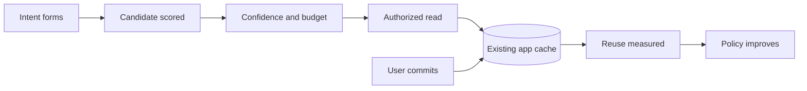

Your application can often see the next action forming. A link stays under the pointer. A control
receives focus. The current route makes one destination far more likely than the rest.

**Cogni turns that early intent into useful lead time.** It begins a small number of authorized,
read-only operations before the user commits, places the result where the application already
expects it, and measures whether the real action reused the work.

The goal is not more prefetching. It is less waiting.

<Columns cols={2}>
  <Card
    title="See the system"
    icon="diagram-project"
    href="/how-cogni-works"
    cta="How Cogni works"
    arrow="true"
  >
    Follow a prediction from intent to an authorized read, cache reuse, and evidence.
  </Card>
  <Card
    title="Try one route"
    icon="bolt"
    href="/client-quickstart"
    cta="Open the quickstart"
    arrow="true"
  >
    Start with one likely navigation and prove that the foreground path used the result.
  </Card>
</Columns>

## Move latency out of the click

Most loading starts after commitment: click, request, response, render. Faster servers shorten that
chain. Cogni changes when part of it begins.

If a read normally takes 400 ms and a trustworthy signal starts it 250 ms before the click, only
about 150 ms remains on the critical path. The server did not get faster. The application found
useful time that was already there.

| Path                      |   Read begins | Wait after commitment |
| ------------------------- | ------------: | --------------------: |
| Ordinary loading          | At commitment |                400 ms |
| Cogni with 250 ms of lead | 250 ms before |                150 ms |

That example hides 62.5 percent of the dependency's latency. It is an illustration, not a benchmark.
Real benefit depends on read latency, available lead time, and how often the prediction is reused.

## Prediction should earn its cost

Prefetching every visible link can look fast in a demo while quietly wasting bandwidth, server
capacity, memory, and cache space. Cogni treats every prediction as a claim that must be specific
enough to test.



A candidate declares what may be needed, how likely reuse is, how long that prediction remains
useful, and what it costs. Cogni admits it only when confidence and shared budgets allow the work.
The result goes into the same router or data cache that ordinary navigation reads.

This last part matters most: **a completed request is not a successful prediction.** The prediction
is correct only when the committed action consumes that representation before it expires or is
invalidated. Cogni measures reuse, misses, cancellation, failure, lead time, and bytes so a policy
can improve or stop running.

## Speed without a second architecture

Cogni does not replace your router, cache, backend, or authorization model. It coordinates the
moment when trusted reads begin.

<Columns cols={2}>
  <Card title="Foreground first" icon="person-running">
    Navigation, input, rendering, and committed requests outrank speculative work.
    Prediction yields when the application is busy.
  </Card>
  <Card title="One shared budget" icon="gauge-high">
    Confidence gates, priorities, deduplication, concurrency limits, and horizons
    prevent scattered prefetch calls from competing without restraint.
  </Card>
  <Card title="Reads only" icon="shield-check">
    Cogni never predicts a purchase, submission, send, publish, delete, or any other
    side effect. Ordinary authorization and tenancy checks remain authoritative.
  </Card>
  <Card title="Your cache stays central" icon="database">
    Predicted work populates the representation the foreground path already consumes.
    There is no parallel Cogni data model to keep in sync.
  </Card>
</Columns>

## Start with the link you already have

Framework adapters turn existing navigation into measured prediction. In Next.js, a link can opt
into Cogni while the App Router continues to own navigation and its route cache:

```tsx
import { NextCogniProvider, PredictiveLink } from "@inttegro/cogni-next";

export function Navigation() {
  return (
    <NextCogniProvider>
      <PredictiveLink href="/orders" probability={0.92} horizonMs={30_000}>
        Orders
      </PredictiveLink>
    </NextCogniProvider>
  );
}
```

Cogni waits for sustained hover by default, responds immediately to stronger intent such as focus,
touch, or pointer-down, and keeps ordinary navigation available after a miss or failure.

The same model is available for React Router, TanStack Router, Astro, and custom React integrations.
The client runtime is framework-neutral, and the backend protocol can be implemented in any language.

<Columns cols={2}>
  <Card
    title="React Router"
    icon="react"
    href="/react-router"
    cta="Use PredictiveLink"
    arrow="true"
  >
    Keep React Router's link model while routing prefetch through Cogni's admission and
    accounting.
  </Card>
  <Card
    title="TanStack Router"
    icon="route"
    href="/tanstack-router"
    cta="Use PredictiveLink"
    arrow="true"
  >
    Back prediction with the router's route preload and confirm reuse when navigation
    commits.
  </Card>
  <Card
    title="Next.js"
    icon="n"
    href="/next"
    cta="Use the App Router adapter"
    arrow="true"
  >
    Coordinate `router.prefetch()` through one shared budget instead of independent link
    behavior.
  </Card>
  <Card
    title="Astro"
    icon="star"
    href="/astro"
    cta="Use the Astro runtime"
    arrow="true"
  >
    Add predictive links through a delegated browser runtime that survives client route
    swaps.
  </Card>
</Columns>

## Adopt what the evidence supports

Start with one route that is both likely and expensive enough to matter. Give it a stable cache key,
a realistic reuse horizon, and a calibrated probability. Then inspect the outcomes.

Expand when Cogni shows that committed actions repeatedly reuse the work and avoid meaningful wait.
Tighten the gate, delay the work, or remove the policy when it does not. This keeps predictive loading
an optimization you can trust instead of a growing collection of hopeful requests.

<Columns cols={2}>
  <Card
    title="Build the first prediction"
    icon="code"
    href="/client-quickstart"
    cta="Start the client quickstart"
    arrow="true"
  >
    Connect one reusable read, preserve the foreground fallback, and inspect the
    outcome.
  </Card>
  <Card
    title="Understand correctness"
    icon="chart-line"
    href="/why-cogni"
    cta="See why reuse matters"
    arrow="true"
  >
    Learn why completion is not enough and how confidence becomes permission to spend.
  </Card>
</Columns>

<Note>
  Cogni follows semantic versioning. During the `0.x` series, minor releases may change
  public APIs and will include migration notes in the changelog.
</Note>
