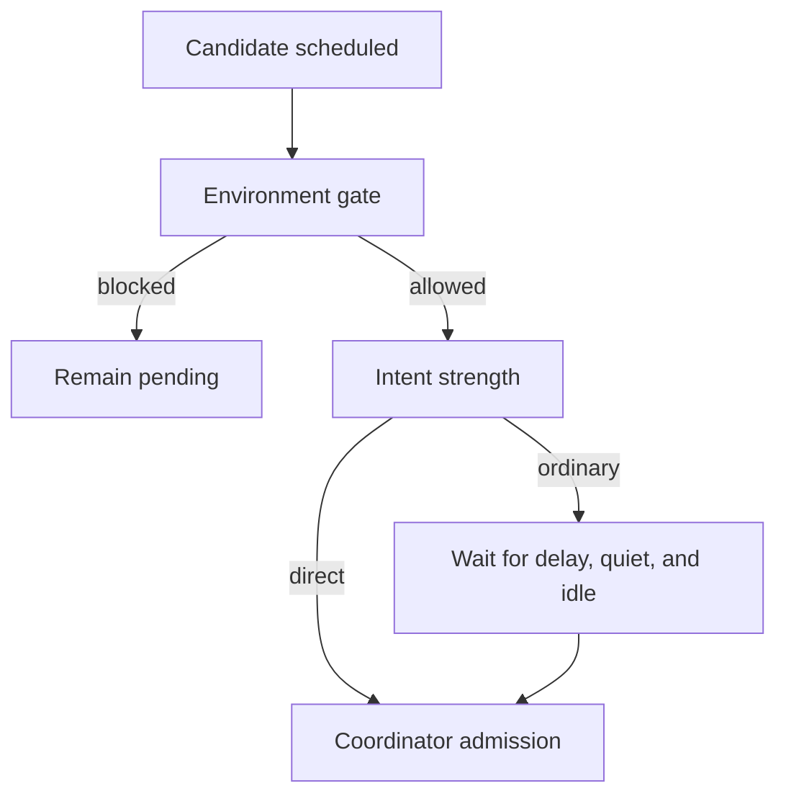

The coordinator decides whether a candidate deserves capacity. `PredictionScheduler` decides when
to spend it using delay, foreground activity, browser conditions, and idle opportunities.

## Schedule background work

```typescript
import {
  PredictionScheduler,
  type PredictionCandidate,
  type PredictionLoader,
} from "@inttegro/cogni-client";
import {
  createBrowserPredictionSchedulerRuntime,
  observeBrowserPredictionEnvironment,
} from "@inttegro/cogni-client/browser";

const scheduler = new PredictionScheduler({
  runtime: createBrowserPredictionSchedulerRuntime(),
  coordinatorOptions: { maxConcurrent: 2 },
});

const stopEnvironment = observeBrowserPredictionEnvironment((decision) => {
  scheduler.setEnvironmentAllowed(decision.allowed);
});

export function schedulePrediction(
  candidate: PredictionCandidate,
  loader: PredictionLoader,
) {
  return scheduler.schedule(candidate, loader, {
    delayMs: 500,
    idle: true,
    idleTimeoutMs: 2_500,
    maxDeferMs: 750,
  });
}

export function disposePredictions(): void {
  stopEnvironment();
  scheduler.dispose();
}
```

`ScheduledPrediction` remains `pending` until its gates pass. `started` resolves to a
`PredictionHandle`, or `null` if cancelled first.

## Scheduling gates

Four conditions shape the start time:

1. `delayMs` is a soft delay before the candidate becomes eligible.
2. Foreground activity blocks ordinary background starts.
3. `idle: true` requests an idle opportunity after the other gates pass.
4. The environment gate can block every start.



The soft delay filters transient intent. Foreground activity protects committed work. Idle waits for
headroom. The environment gate can veto prediction. `idleTimeoutMs` only limits the idle wait.

`maxDeferMs` can bypass foreground and idle waits after a ceiling, but never the environment gate.
Omit it when foreground activity may defer warmup indefinitely.

When foreground activity transitions from a positive count back to zero, soft delays restart. When
the environment becomes allowed again, both soft delays and maximum-defer clocks restart.

## Foreground activity

Feed the host's active foreground request count into the scheduler:

```typescript
function onForegroundRequestCountChanged(activeRequests: number): void {
  scheduler.setForegroundActivity(activeRequests);
}
```

The value must be a non-negative integer. `allowDuringForeground: true` can exempt one item, though
direct intent usually expresses the reason more clearly.

## Direct intent

`ScheduledPrediction.startNow()` treats pointer down or focus as direct intent, bypassing delay, idle,
and foreground waits while respecting the environment gate.

`IntentPrefetchController` provides a framework-neutral delayed signal for hover-like intent and an
immediate path for pointer, focus, touch, or click:

```typescript
import { IntentPrefetchController } from "@inttegro/cogni-client";

const scheduledByKey = new Map<string, ReturnType<typeof schedulePrediction>>();

const intent = new IntentPrefetchController<string>({
  delayMs: 50,
  run(key) {
    scheduledByKey.get(key)?.startNow();
  },
  onError(error) {
    console.error("Prediction intent failed", error);
  },
});

export function registerScheduledPrediction(
  key: string,
  prediction: ReturnType<typeof schedulePrediction>,
): void {
  scheduledByKey.set(key, prediction);
}

export function onPointerEnter(key: string): void {
  intent.schedule(key);
}

export function onPointerLeave(): void {
  intent.cancel();
}

export function onPointerDownOrFocus(key: string): void {
  intent.runNow(key);
}
```

The controller defaults to 120 ms. `runNow()` cancels the delay; errors go to `onError` without
affecting the committed interaction.

## Cancel obsolete work

Cancel a key when invalidation, tenant changes, or route policy makes it obsolete:

```typescript
scheduler.cancel("account:app_123:products:first-page");
```

Pending cancellation resolves `started` with `null`. Once work has entered the coordinator, the
scheduler forwards cancellation to its prediction handle and aborts the loader.

Calling `dispose()` cancels all pending schedules. It also disposes the coordinator when the
scheduler created that coordinator itself. If you inject `options.coordinator`, its lifetime remains
the caller's responsibility.

## Continue

- [Browser runtime and navigation metrics](/browser-and-navigation) details environment decisions,
  idle fallback, and timing evidence.
- [Client API reference](/client-api) lists scheduler and intent signatures.
